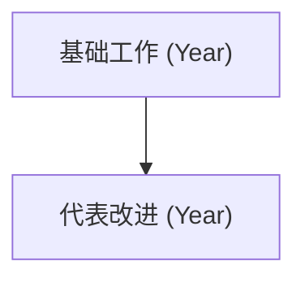

# [主题或总览名称]

> [!abstract] 核心脉络
> <!-- 一句话概括本总览覆盖的研究主线与知识库导航入口。 -->

## 论文演进脉络图

## 分类目录

### 一、[主题方向一]

| 论文 | 年份 | 核心问题与关键方法 |
| --- | :---: | --- |
| [[已有论文笔记]] | YYYY | 一句话说明问题与核心方法 |

## 按研究场景速查

- **[场景或问题一]**：[[已有论文笔记 A]] · [[已有论文笔记 B]]
